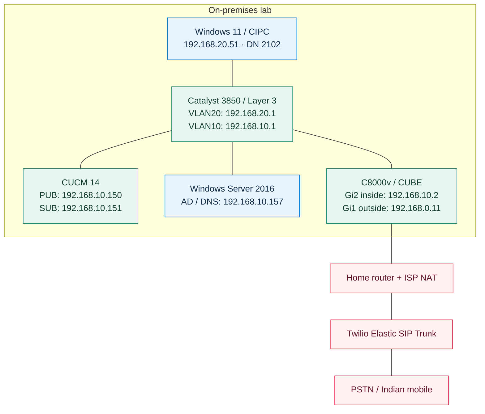

# Cisco CUCM + CUBE + Twilio

### From a registered softphone to a real PSTN conversation

**A complete outbound calling lab: architecture → configuration → signaling → one-way audio → recovery.**

   

> **The moment that matters:** the mobile rings, the remote caller tune reaches CIPC, and both people can hear each other. Getting there requires more than a successful SIP response.

This walkthrough follows a real Cisco Collaboration lab built by [raysaliveonline-commits](https://github.com/raysaliveonline-commits). It begins with Twilio, finishes every CUCM object, then completes CUBE configuration before tracing a call. It includes the failures that made the successful result understandable.

## 01 · Picture the deployment



The diagram shows network attachment. The following table shows **which applications actually talk to each other**:

| Function | Path in the verified call | Protocol |
|---|---|---|
| Phone registration and call control | CIPC ↔ CUCM | SIP over TCP |
| Internal trunk signaling | CUCM ↔ CUBE | SIP over TCP / 5060 |
| Provider trunk signaling | CUBE ↔ Twilio | SIP over TCP / 5060 |
| Internal audio | CIPC ↔ CUBE, routed through the Catalyst | RTP over UDP |
| External audio | CUBE ↔ Twilio, through NAT | RTP over UDP |
| Name resolution | CUBE → WS2016 DNS | DNS |

**CUCM controls this call; it does not carry its audio.** CUBE anchors the two media legs. The phone's registration transport and each trunk's transport are separate settings.

### What was actually verified?

| Result | Evidence |
|---|---|
| Outbound PSTN calling | Indian destinations rang |
| Authentication | Authenticated INVITE progressed after a 407 challenge |
| Early media | Remote caller tune heard in CIPC; 183 with SDP in the log |
| Two-way audio | Both people heard each other after the NAT-related recovery |
| Normal clearing | BYE / 200 OK; normal-clearing cause 16 |

**Scope:** the tested endpoint is PC2 / DN 2102 using SIP/TCP. UDP and TLS phones already existed, but this guide does not claim separate PSTN audio tests from all three. Inbound PSTN calling, failover, emergency calling and TLS/SRTP are not validated by this test. Windows 11 with legacy CIPC is a lab interoperability result, not a production support certification.

### Follow the build

1. [Learn the terms and prepare your values](#02--learn-the-terms-and-prepare-your-values)
2. [Finish Twilio](#03--finish-twilio)
3. [Verify DNS from WS2016 and PC2](#04--verify-dns-from-ws2016-and-pc2)
4. [Check the routed network](#05--check-the-routed-network)
5. [Finish every CUCM object](#06--finish-every-cucm-object)
6. [Finish C8000v and CUBE](#07--finish-c8000v-and-cube)
7. [Make one observable call](#08--make-one-observable-call)
8. [Understand the failure and recovery](#09--understand-the-failure-and-recovery)
9. [Read the successful call](#10--read-the-successful-call)
10. [Follow the packet story](#11--follow-the-packet-story)
11. [Use the Wireshark filters](#12--use-the-wireshark-filters)
12. [Troubleshoot and preserve the result](#13--troubleshoot-and-preserve-the-result)
13. [References](#14--references)

---

## 02 · Learn the terms and prepare your values

| Term | Meaning here |
|---|---|
| CIPC | Cisco IP Communicator, the software telephone |
| CUCM | Call-control server: registers phones, applies permissions and chooses routes |
| CUBE | Cisco Unified Border Element: connects internal and provider SIP call legs |
| SIP | Signaling used to establish, modify and end calls |
| SDP | Media description inside SIP: addresses, ports, codecs and direction |
| RTP | Packets carrying encoded audio |
| PSTN | Public switched telephone network |
| Calling party | Who is calling |
| Called party | The destination they want to reach |
| E.164 representation | `+` followed by country code and subscriber digits |
| Twilio Termination | Calls leaving our infrastructure toward the PSTN |
| Twilio Origination | New calls arriving from the PSTN toward our infrastructure |
| Dial-peer | CUBE configuration describing selection and handling of a call leg |
| MTP | Media Termination Point, a media resource; not required merely because a SIP trunk exists |

### Deployment values

| Item | Value |
|---|---|
| Internal domain | `ccie.collab` |
| Internal DNS | `192.168.10.157` |
| CUCM PUB / SUB | `192.168.10.150` / `192.168.10.151` |
| PC2 | `192.168.20.51`, extension `2102` |
| CUBE inside / outside | `192.168.10.2` / `192.168.0.11` |
| Home-router LAN gateway | `192.168.0.1` |
| Software observed | CUCM 14; C8000v IOS XE 17.15.4c; CUBE 14.10 |
| Trunk hostname used in this lab | `ccie-collab.pstn.twilio.com` |

> **Use your own provider trunk.** The published hostname illustrates the working lab; do not direct your calls to it. Replace it with the termination hostname assigned to your Twilio trunk.

The following placeholders intentionally protect account details:

| Placeholder | Replace with |
|---|---|
| `<YOUR_TWILIO_NUMBER_E164>` | Your owned/authorized external calling number |
| `<INDIA_TEST_NUMBER_E164>` | A permitted Indian test destination in `+91…` format |
| `<YOUR_SIP_PASSWORD>` | A unique SIP credential password |
| `<YOUR_PUBLIC_EGRESS_IP>` | The public signaling source Twilio actually sees |
| `<PROVIDER_MEDIA_IP>` | The media address in your own call's SDP |

Do not paste angle-bracket placeholders literally. Usernames below are generic. No real telephone numbers, MAC addresses, passwords, account SIDs, provider public IPs or raw captures are published.

**Prerequisites:** a working registered CIPC, an existing routed PC/server network, DNS, a paid Twilio account and an owned voice-capable number. Number rental and call usage are separate charges; check the current destination rate before testing. A DNS lookup or local configuration change does not itself place a PSTN call.

---

## 03 · Finish Twilio

### 3.1 Create the Elastic SIP Trunk

In Twilio Console, open **Elastic SIP Trunking → Trunks → Create new SIP Trunk**.

Example friendly name:

```text
HQ-LAB-PSTN
```

This name organizes the Console. CUBE uses the termination hostname, not the friendly name.

Open **Termination** and assign a unique termination name. Record the full hostname Twilio displays. Our example is:

```text
ccie-collab.pstn.twilio.com
```

`ccie.collab` is our internal AD/DNS domain. `ccie-collab.pstn.twilio.com` identifies the provider service. Similar names are convenient, but no matching requirement exists.

**Where you will see it:** DNS queries, the CUBE `session target`, and the provider-facing SIP Request-URI.

### 3.2 Attach an IP Access Control List

Add:

```text
<YOUR_PUBLIC_EGRESS_IP>/32
```

`/32` means one IPv4 address. Use the actual public signaling egress address, not CUBE's private address or the home router's private `10.x.x.x` WAN address.

Our home-router WAN was private while an external IP-check site showed a different public address: the path included upstream NAT. A website result is an initial clue; provider logs or signaling observations establish which public source Twilio actually sees. Dynamic egress changes can invalidate an ACL entry.

Failure to ping your own public address from inside does not prove outbound SIP will fail. ICMP and SIP/TCP are different tests.

### 3.3 Create and attach a Credential List

Create a generic credential such as:

```text
Username: lab-sip-user
Password: <YOUR_SIP_PASSWORD>
```

**Attach its Credential List to the trunk.** Merely creating a credential is incomplete.

This lab used both an ACL and credentials. **When both are attached, both checks must pass.** See [Twilio authentication and termination documentation](https://www.twilio.com/docs/sip-trunking).

During a call, Twilio can send `407 Proxy Authentication Required`. CUBE acknowledges that response and sends a new INVITE with digest credentials. Judge the authenticated retry, not the challenge alone.

### 3.4 Associate the number

Open **Trunk → Numbers** and associate your purchased voice-capable number.

The number supplies an authorized public identity in this example. It does not replace DN 2102 inside CUCM. Multiple permitted extensions can present one company number, subject to provider policy and account limits.

### 3.5 Permit the destination

Open **Voice Geographic Permissions** and allow the required test destinations. Use **Phone Number Permission Check** if available. For this lab, test destinations were in India.

Permission allows an attempt; it is not an inclusive calling plan or guarantee of delivery.

### 3.6 Record the remaining settings

| Setting | Lab treatment | Purpose |
|---|---|---|
| Origination URIs | Empty | New inbound PSTN calls are outside this chapter |
| CNAM Lookup | Off | Not needed for the outbound call |
| Advanced Voice Insights | Optional | Additional diagnostics, not a prerequisite |
| Secure Trunking | Disabled | Baseline is TCP signaling and unencrypted RTP |
| Symmetric RTP | Initially disabled; enabled during recovery | Learns the observed RTP source for return media |

Do not enable emergency services or attempt emergency test calls as part of this lab. An empty Origination URI list does **not** prevent return RTP on an existing outbound call.

**Twilio checkpoint:** hostname recorded, credential list and ACL attached, number associated, intended destination permitted. No SIP REGISTER from CUBE is required in the configuration used here.

---

## 04 · Verify DNS from WS2016 and PC2

### 4.1 Ask the actual lab DNS server

On WS2016 PowerShell:

```powershell
$TrunkFqdn = 'ccie-collab.pstn.twilio.com'

Resolve-DnsName -Name $TrunkFqdn `
    -Type A `
    -Server 192.168.10.157 `
    -DnsOnly
```

| Element | Meaning |
|---|---|
| `$TrunkFqdn` | Reusable variable holding the hostname |
| `Resolve-DnsName` | Performs the lookup |
| `-Type A` | Requests IPv4 address records |
| `-Server` | Queries WS2016 at the specified address |
| `-DnsOnly` | Restricts the resolution method to DNS |
| Backtick | Continues the PowerShell command; do not add trailing spaces after it |

Expected: one or more provider-managed address records, possibly through aliases. Do not copy those answers into a permanent host entry. Do not create a replacement A record for the provider hostname in your internal zone.

### 4.2 Test TCP from Windows

```powershell
Test-NetConnection -ComputerName $TrunkFqdn `
    -Port 5060 `
    -InformationLevel Detailed
```

Look for `TcpTestSucceeded : True`.

| Test | What success proves | What it does not prove |
|---|---|---|
| DNS lookup | This DNS server resolves the name | SIP authentication or audio |
| TCP test | This Windows machine reaches the selected address/port | Reachability from CUBE or a completed call |

### 4.3 Repeat name resolution on PC2

```cmd
nslookup ccie-collab.pstn.twilio.com 192.168.10.157
```

In Wireshark, use this **display filter**:

```wireshark
dns.qry.name == "ccie-collab.pstn.twilio.com"
```

This manual lookup verifies DNS. It does not mean CIPC itself discovers Twilio: **CIPC talks to CUCM; CUBE uses the provider hostname.** Existing internal SIP SRV records are not what selects this explicit CUBE session target.

**DNS checkpoint:** resolve through the lab DNS server before troubleshooting SIP.

---

## 05 · Check the routed network

The Catalyst already routes the PC and server VLANs. This guide builds on that working foundation rather than replacing switch configuration.

On the Catalyst:

```cisco
show ip interface brief
show ip route 192.168.20.51
show ip route 192.168.10.2
ping 192.168.10.2 source Vlan10
ping 192.168.20.51 source Vlan20
```

The route lookups identify the path. The source-specific pings make the source network explicit. An endpoint firewall may affect ICMP, so distinguish an ICMP failure from a verified routing failure.

On PC2:

```powershell
Get-NetIPConfiguration
Test-Connection 192.168.20.1 -Count 2
Test-Connection 192.168.10.2 -Count 2
```

Verify PC2's gateway is `192.168.20.1` and DNS is `192.168.10.157`.

**Historical correction:** the static route explicitly added and verified in our session was on **CUBE**, pointing the PC subnet to the Catalyst:

```cisco
ip route 192.168.20.0 255.255.255.0 192.168.10.1
```

It appears in the complete CUBE configuration below. No unverified new switch route is claimed here.

---

## 06 · Finish every CUCM object

Build in dependency order. The trunk can remain unavailable until CUBE is configured in the next chapter.

| Object | Name used in the guide | Job |
|---|---|---|
| Trunk security profile | `SIP-TRUNK-CUBE-TCP` | Transport and security |
| SIP profile | `SIP-PROFILE-HQ-CUBE` | SIP behavior and OPTIONS |
| Trunk | `TRUNK-HQ-CUBE` | Destination CUBE |
| Route group | `RG-HQ-CUBE-TWILIO` | Holds the trunk |
| Route list | `RL-HQ-TWILIO` | Selects the route group |
| Partition | `PT-HQ-PSTN-TEST` | Contains the PSTN route pattern |
| CSS | `CSS-HQ-PSTN-TEST` | Grants access to selected partitions |
| Route pattern | `91XXXXXXXXXX` | Matches the dialed destination |

Names are labels, not protocol requirements. A previously saved label with a different spelling can remain if every reference points to the right object.

### 6.1 SIP trunk security profile

**System → Security → SIP Trunk Security Profile → Add New**

| Field | Value |
|---|---|
| Name | `SIP-TRUNK-CUBE-TCP` |
| Device Security Mode | Non Secure |
| Incoming Transport Type | TCP+UDP |
| Outgoing Transport Type | TCP |
| Incoming Port | 5060 |
| Enable Digest Authentication | Unchecked |

Save. Non Secure incoming TCP+UDP is a CUCM profile behavior; outgoing TCP controls CUCM-initiated signaling. **TCP is reliable transport, not encryption.**

Twilio's digest challenge belongs on the external CUBE leg. Enabling digest on this CUCM trunk is not the same operation. See [Cisco's trunk security guide](https://www.cisco.com/c/en/us/td/docs/voice_ip_comm/cucm/security/14SU2/cucm_b_security-guide-14su2/cucm_m_trunk-and-gateway-sip-security_reog.html).

### 6.2 Dedicated SIP profile

**Device → Device Settings → SIP Profile → find Standard SIP Profile → Copy**

| Field | Value |
|---|---|
| Name | `SIP-PROFILE-HQ-CUBE` |
| Early Offer support for voice and video calls | Best Effort — no MTP inserted |
| Enable OPTIONS Ping for applicable trunks | Enabled |
| In-service interval | 10 seconds |
| Out-of-service interval | 60 seconds |
| Other settings | Retain copied defaults unless a documented requirement applies |

Save the copy; do not change the shared standard profile for all phones.

**Early offer:** the initial INVITE includes SDP. **Delayed offer:** it does not. Best Effort uses available endpoint media information without inserting an MTP solely to create the offer. CUBE will force early offer on its provider leg. See [Cisco Collaboration call-control design](https://www.cisco.com/c/en/us/td/docs/solutions/CVD/Collaboration/enterprise/14/collbcvd/control.html).

OPTIONS tests SIP responsiveness. A 200 OK to OPTIONS is not proof of a completed call or working audio.

### 6.3 Trunk to CUBE

**Device → Trunk → Add New**

```text
Trunk Type: SIP Trunk
Device Protocol: SIP
Trunk Service Type: None (Default)
```

| Field | Value |
|---|---|
| Device Name | `TRUNK-HQ-CUBE` |
| Description | HQ PSTN through CUBE |
| Device Pool | `DP-HQ-INDIA` |
| Destination Address | `192.168.10.2` |
| Destination Port | 5060 |
| SIP Trunk Security Profile | `SIP-TRUNK-CUBE-TCP` |
| SIP Profile | `SIP-PROFILE-HQ-CUBE` |
| Media Termination Point Required | Unchecked |
| Incoming Calling Search Space | None for this outbound-only baseline |

Save and apply/reset as CUCM requests.

CUCM sends the call to **CUBE's inside interface**. Incoming CSS on the trunk controls calls entering CUCM from that trunk; it does not authorize PC2's outbound dialing. A SIP trunk does not register like CIPC—do not look for a phone-style REGISTER exchange.

### 6.4 Route group

**Call Routing → Route/Hunt → Route Group → Add New**

Create `RG-HQ-CUBE-TWILIO`. Select `TRUNK-HQ-CUBE`, add it to the selected devices, and save. With one member, the distribution choice does not provide an alternative carrier path; retain the default unless your design requires otherwise.

### 6.5 Route list

**Call Routing → Route/Hunt → Route List → Add New**

| Field | Value |
|---|---|
| Name | `RL-HQ-TWILIO` |
| Cisco Unified Communications Manager Group | Existing `CMG-HQ-LAB` |
| Enable this Route List | Checked |

Save, then **Add Route Group → RG-HQ-CUBE-TWILIO**. Retain default route-list-detail transformation behavior. Do not add another prefix, mask or digit-stripping instruction here. Save and reset if requested.

| Object | Decision |
|---|---|
| Route pattern | Does the dialed number match? |
| Route list | Which ordered group should be tried? |
| Route group | Which member trunk/gateway carries the call? |
| Trunk | Which SIP destination receives it? |

### 6.6 Partition and calling search space

**Call Routing → Class of Control → Partition → Add New**

Create `PT-HQ-PSTN-TEST`.

Then **Call Routing → Class of Control → Calling Search Space → Add New**:

```text
CSS-HQ-PSTN-TEST
  PT-HQ-INTERNAL
  PT-HQ-SERVICES
  PT-HQ-PSTN-TEST
```

Save. A partition contains dial-plan objects. A CSS is the ordered list of partitions the caller can search. Placing a route in a partition does not grant every phone access to it.

### 6.7 India route pattern and number transformations

**Call Routing → Route/Hunt → Route Pattern → Add New**

| Field | Value |
|---|---|
| Route Pattern | `91XXXXXXXXXX` |
| Route Partition | `PT-HQ-PSTN-TEST` |
| Gateway/Route List | `RL-HQ-TWILIO` |
| Route Option | Route this pattern |
| Call Classification | OffNet |
| Provide Outside Dial Tone | Unchecked |
| Called Party Discard Digits | None |
| Called Party Prefix Digits | `+` |
| Calling Party Transformation Mask | `<YOUR_TWILIO_NUMBER_E164>` |
| Use Calling Party's External Phone Number Mask | Unchecked when using the explicit calling mask |

Save and reopen to verify both **OffNet** and the unchecked outside-dial-tone setting.

`91` is the country code; each `X` matches one digit. There is **no separate outside-access 9** in this dial plan.

| Number | Before | After |
|---|---|---|
| Called party | `91` plus ten destination digits | `+91` plus ten destination digits |
| Calling party | Internal extension `2102` | Your authorized Twilio number |

These are two different transformations. Changing caller ID does not change the called destination. No separate translation pattern is required for this simple design.

### 6.8 Authorize the phone

**Device → Phone → PC2 → Line 1**

| Field | Value |
|---|---|
| Directory Number | 2102 |
| Route Partition | `PT-HQ-INTERNAL` |
| Line Calling Search Space | `CSS-HQ-PSTN-TEST` |
| Line Text Label | `PSTN HQ 2102` |

Keep the phone-level CSS as `CSS-HQ-INTERNAL`. For ordinary originating calls, CUCM combines line and device CSS; the line CSS supplies PSTN access here.

**Do not move DN 2102 into the PSTN partition.** Its partition governs how others find it; its CSS governs what it can find.

Preserve the existing phone registration settings:

```text
Device Security Profile: existing SIP/TCP phone profile
SIP Profile: Standard SIP Profile
Device Pool: DP-HQ-INDIA
Line 2: unassigned
```

The trunk profiles do not belong on the phone. Save and apply configuration as needed. A PSTN Access checkbox elsewhere is not a substitute for this route-pattern/partition/CSS chain.

### 6.9 Optional presentation and CUCM checkpoint

Use a meaningful Display/ASCII Display such as `HQ Lab`, and line label `PSTN HQ 2102`. An external phone number mask can be used for presentation, but the explicit route-pattern mask is the outbound caller-ID mechanism chosen here. A screen label alone does not set PSTN caller ID.

- [ ] CIPC remains registered; DN 2102 remains internal.
- [ ] Line CSS includes the PSTN route-pattern partition.
- [ ] Pattern → route list → route group → trunk references are correct.
- [ ] Trunk points to `192.168.10.2:5060`.
- [ ] Number changes are not duplicated at another routing level.
- [ ] No MTP is forced merely because this is a SIP trunk.

**CUCM is complete. Now finish CUBE.**

---

## 07 · Finish C8000v and CUBE

### 7.1 Read the CLI correctly

| Syntax | Meaning |
|---|---|
| `CCIE#` | Privileged EXEC: show, copy, debug |
| `CCIE(config)#` | Global configuration |
| `CCIE(config-dial-peer)#` | Dial-peer configuration |
| `exit` | Up one configuration level |
| `end` | Return to privileged EXEC |
| `!` | Comment/separator, not a required audio command |
| `<PLACEHOLDER>` | Replace before use |

Paste commands without the device prompt. A literal password is not surrounded by decorative quote marks.

### 7.2 Save a baseline

```cisco
copy running-config bootflash:before-cube.cfg
```

Press Enter to accept the proposed filename. This preserves a reference before changing the device role. It is not a license backup or a substitute for a full recovery plan.

### 7.3 Interfaces, routes and DNS

Apply only settings missing from your matching lab:

```cisco
configure terminal

interface GigabitEthernet1
 description OUTSIDE-TO-HOME-ROUTER
 ip address 192.168.0.11 255.255.255.0
 no shutdown
exit

interface GigabitEthernet2
 description INSIDE-TO-CUCM
 ip address 192.168.10.2 255.255.255.0
 no shutdown
exit

ip route 0.0.0.0 0.0.0.0 192.168.0.1
ip route 192.168.20.0 255.255.255.0 192.168.10.1

ip domain lookup
ip domain name ccie.collab
ip name-server 192.168.10.157

end
write memory
```

| Configuration | Why it exists |
|---|---|
| Default route via `192.168.0.1` | Unknown destinations go toward the home router |
| Phone-subnet route via `192.168.10.1` | Return traffic to phones goes through the Catalyst, not the Internet default |
| DNS server | Resolves the provider session target |
| Inside/outside interface addresses | Provide explicit attachment points for signaling/media bindings |

Gi3 was unused in this test. A historical `ip nat outside` line existed on Gi1, but no corresponding CUBE NAT rule was verified. That label alone does not perform NAT; upstream NAT handled the tested Internet path. Do not invent an inside/outside NAT configuration from that one line.

Verify:

```cisco
show ip interface brief
show ip route 0.0.0.0
show ip route 192.168.20.0
show hosts
ping 192.168.10.150 source GigabitEthernet2
ping 192.168.20.51 source GigabitEthernet2
ping ccie-collab.pstn.twilio.com
```

`show hosts` reveals name servers and cached answers. A provider need not reply to ICMP; a failed ping alone is not proof of a failed SIP service.

### 7.4 Activate the boot level used in this lab

Initially, expected voice commands were unavailable. We applied:

```cisco
configure terminal
license boot level network-essentials addon dna-essentials
end
write memory
```

Verify the saved and next-boot settings:

```cisco
show running-config | include ^license
show startup-config | include ^license
show version | include License Level|license Level
```

Reload during a lab maintenance window:

```cisco
reload
```

After boot:

```cisco
show version | include License Level|license Level
show cube status
show voice sip license status
show license summary
```

Observed: `network-essentials`, `dna-essentials`, CUBE 14.10, IOS XE 17.15.4c, and SIP service Up.

**Feature availability is not license entitlement.** This boot-level change made the relevant commands available in our lab; a successful call does not establish that CUBE session licensing is purchased or compliant. See [Cisco's C8000v boot-level procedure](https://www.cisco.com/c/en/us/support/docs/ios-nx-os-software/ios-xe-17/217047-enable-license-boot-level-and-addon-on-c.html).

### 7.5 Enable border-element operation

```cisco
configure terminal

voice service voip
 ip address trusted list
  ipv4 192.168.10.150 255.255.255.255
  ipv4 192.168.10.151 255.255.255.255
 exit
 mode border-element
 allow-connections sip to sip
exit

end
write memory
```

| Command | Purpose |
|---|---|
| `voice service voip` | Enter global VoIP service configuration |
| Trusted list | Permit the intended CUCM signaling sources |
| `mode border-element` | Select border-element operation |
| `allow-connections sip to sip` | Connect incoming and outgoing SIP call legs |

Our device requested a reload for `mode border-element`; save and reload if prompted. Then verify:

```cisco
show running-config | section voice service voip
show cube status
```

A `trace` line also appeared in our running configuration. It relates to diagnostics; it is not a route, credential, or instruction that grants audio connectivity. Provider-initiated inbound calls would require a separate reviewed trust and routing design.

### 7.6 Recognize incoming CUCM signaling

```cisco
configure terminal

voice class uri 100 sip
 host ipv4:192.168.10.150
 host ipv4:192.168.10.151
exit

end
```

`100` is a local tag—not port 100 or extension 100. The incoming dial-peer will use this class to match the SIP Via host. See [Cisco call routing](https://www.cisco.com/c/en/us/support/docs/voice/ip-telephony-voice-over-ip-voip/211306-In-Depth-Explanation-of-Cisco-IOS-and-IO.html).

### 7.7 Incoming CUCM dial-peer

```cisco
configure terminal

dial-peer voice 100 voip
 description INBOUND-FROM-CUCM
 session protocol sipv2
 session transport tcp
 incoming uri via 100
 voice-class sip bind control source-interface GigabitEthernet2
 voice-class sip bind media source-interface GigabitEthernet2
 dtmf-relay rtp-nte
 codec g711ulaw
 no vad
exit

end
write memory
```

| Command | Use case | Where to observe it |
|---|---|---|
| `session protocol sipv2` | SIP signaling | SIP debug |
| `session transport tcp` | TCP transport setting | TCP/SIP exchange |
| `incoming uri via 100` | Identify the CUCM-originated call | Via host and dial-peer diagnostics |
| Control bind to Gi2 | Inside signaling address | SIP signaling |
| Media bind to Gi2 | Inside media address | SDP and RTP connections |
| `codec g711ulaw` | G.711 μ-law | SDP `PCMU/8000` |
| `dtmf-relay rtp-nte` | RTP telephone events for DTMF | SDP `telephone-event` |
| `no vad` | Disable silence suppression on this leg | Configuration and media behavior |

**Inbound describes call setup direction, not one-way audio permission.** The established leg carries media in both directions. Explicit bindings make the two network sides predictable; see [Cisco SIP binding](https://www.cisco.com/c/en/us/td/docs/ios-xml/ios/voice/cube/ios-xe/config/ios-xe-book/m_voi-sip-bind.html).

### 7.8 Resolve the credential-storage prerequisite

Our first authentication configuration produced:

```text
Failed type 6 encryption on password.
Please configure "key config-key password-encrypt" first.
```

Saving afterward did not make the rejected authentication command valid. Configure the master key interactively:

```cisco
configure terminal
key config-key password-encrypt
```

Follow the prompts and securely retain the private master key. It protects stored credentials and is separate from the SIP password shared with Twilio. Do not replace an existing encryption key casually on a device with other encrypted credentials.

### 7.9 Authentication tenant

While in configuration mode:

```cisco
voice class tenant 200
 authentication username lab-sip-user password 0 <YOUR_SIP_PASSWORD> realm sip.twilio.com
exit

end
write memory
```

| Element | Meaning |
|---|---|
| Tenant 200 | Reusable SIP configuration container |
| Username/password | Must match the Credential List attached to the trunk |
| `password 0` | Plaintext input to this command |
| Realm | Matches the provider authentication challenge |

The outgoing dial-peer must reference the tenant. A saved encrypted value is still sensitive; do not publish credential-bearing configuration or digest authentication headers.

### 7.10 Outgoing provider dial-peer

For an initial controlled test, use an exact permitted E.164 destination as the `destination-pattern`. After that succeeded, our lab expanded to this India pattern:

```cisco
configure terminal

dial-peer voice 200 voip
 description OUTBOUND-TO-TWILIO-INDIA
 destination-pattern +91..........
 session protocol sipv2
 session target dns:ccie-collab.pstn.twilio.com
 session transport tcp
 voice-class sip early-offer forced
 voice-class sip tenant 200
 voice-class sip bind control source-interface GigabitEthernet1
 voice-class sip bind media source-interface GigabitEthernet1
 dtmf-relay rtp-nte
 codec g711ulaw
 no vad
exit

end
write memory
```

Replace the hostname with your own termination hostname before use.

| Command | What it does |
|---|---|
| `destination-pattern +91..........` | Matches `+91` followed by ten digits |
| `session target dns:...` | Resolves the provider signaling destination |
| `session transport tcp` | Uses TCP on this signaling leg |
| `early-offer forced` | Includes an SDP offer in the provider-bound INVITE |
| `tenant 200` | Applies authentication settings |
| Control/media binds to Gi1 | Selects the WAN-facing interface for this leg |
| Codec / DTMF settings | Select the media format and event handling |

CUCM uses `X` in its pattern; IOS uses `.` here. Do not mix wildcard syntaxes. Geographic permissions, provider policy and available balance still apply; a broad dial-peer does not guarantee every matched number is reachable.

### 7.11 How the peers connect

1. CUCM sends an INVITE to CUBE.
2. Its Via host matches URI class 100; CUBE selects incoming peer 100.
3. The called number has already become `+91…` in CUCM.
4. That destination matches outgoing peer 200.
5. CUBE resolves the hostname and establishes the provider call leg.
6. SIP/SDP responses coordinate the two media legs.

CUBE is a **back-to-back user agent**: it creates separate SIP dialogs. Different Call-IDs on the two sides are expected. RTP does not go to port 5060 merely because SIP uses it.

### 7.12 Final CUBE checks

```cisco
show running-config | section voice service voip
show running-config | section voice class uri
show running-config | section dial-peer voice
show dial-peer voice summary
show cube status
show voice sip license status
```

An operational dial-peer proves configuration availability, not successful provider authentication or audio. Review any tenant output privately; omit credentials from shared logs.

---

## 08 · Make one observable call

Prepare capture and diagnostics **before** spending on a call. Use a permitted destination with someone available to answer. Check current billing increments and rates rather than assuming a short call is free.

On CUBE:

```cisco
terminal monitor
debug ccsip messages
```

`terminal monitor` displays diagnostics in the remote terminal. SIP debug shows signaling, not voice payload. Start Wireshark on PC2's Ethernet0, then dial `91` plus the ten destination digits.

While connected:

```cisco
show voip rtp connections
show call active voice brief
```

After the test:

```cisco
undebug all
terminal no monitor
```

| Message | Interpretation |
|---|---|
| INVITE | Request a call |
| 100 Trying | Processing has started |
| 407 | Authentication challenge |
| ACK, then authenticated INVITE | Acknowledge the challenge and retry with credentials |
| 183 with SDP | Progress with media information; early media may follow |
| 200 OK to INVITE | Call answered |
| ACK | Acknowledge the successful final response |
| BYE / 200 OK | End the established call |

**Read CSeq.** A 200 OK to OPTIONS, REGISTER or BYE is not an answered-call indication. REGISTER and INVITE are different SIP methods.

---

## 09 · Understand the failure and recovery

### Failure A: authentication was not complete

Early attempts did not progress successfully through provider authentication. We checked that the credential command had actually been accepted, corrected matching credentials, and ensured the Credential List was attached to the trunk.

The useful distinction is **normal challenge versus failed authenticated retry**. Changing codecs cannot repair an incorrect SIP credential.

### Failure B: ringing worked, returning audio did not

The first answered test had:

| Direction | Result |
|---|---|
| CIPC microphone → mobile | Heard |
| Mobile microphone → CIPC | Not heard |

The failed endpoint capture contained outbound RTP but no corresponding returning UDP stream to CIPC's negotiated media port. The friend hearing CIPC already demonstrated a working microphone and outbound audio path in that call.

**SIP/SDP describes where media should go. NAT changes the actual packet addresses and possibly ports.** A mismatch in the usable return path can leave a call answered but one-way.

CUBE's local debug advertised a private WAN-side address in SDP. That log alone cannot prove exactly what Twilio received after upstream processing, or reveal the public RTP mapping. The evidence supported investigating return-media addressing rather than reinstalling CIPC.

### Recovery: Twilio Symmetric RTP

Open **Trunk → General → Symmetric RTP → Enabled → Save**. Reopen to confirm it remained enabled.

| Setting | Return-media behavior |
|---|---|
| Disabled | Use the destination negotiated in SDP |
| Enabled | Learn the observed incoming RTP source address/port and send return media there |

No CUBE reload was required. After this change, the user heard the remote caller tune and the friend's voice in CIPC; the friend also heard CIPC speech.

> **Supported conclusion:** enabling Symmetric RTP resolved this lab's observed one-way audio, consistent with a NAT-related return-media addressing problem. It did not magically configure inbound PSTN routing or prove every NAT mapping.

Twilio documents both the behavior and media-latching risks. Treat this as a validated lab workaround, not a universal production default. Proper NAT handling and protected signaling/media should be evaluated for production. Read [Twilio's Symmetric RTP guidance](https://www.twilio.com/docs/sip-trunking/risks-associated-with-using-symmetric-rtp).

---

## 10 · Read the successful call

The following timing comes from the successful CUBE debug. Times are **as logged**, not silently converted to local time. Telephone identities and provider addresses are omitted.

| Log time | Event | What it establishes |
|---|---|---|
| 12:16:24.330 | Received 407 | Provider authentication challenge |
| 12:16:32.224 | Received 183 with SDP | External early-media parameters supplied |
| 12:16:32.257 | Sent 183 toward CUCM | Internal media parameters supplied |
| 12:16:38.461 | Received 200 OK to INVITE | External call answered |
| 12:16:38.472–.525 | ACK exchanges | Establishment completed on both legs |
| 12:17:51.533 | Received BYE, USER DISCONNECTED | Remote side ended the call |

Answered duration was approximately **73 seconds**. The subsequent clearing included Q.850 cause 16, normal call clearing.

### Media negotiated for that call

| Leg | CUBE | Remote endpoint |
|---|---|---|
| Internal | `192.168.10.2:8012` | CIPC `192.168.20.51:20670` |
| External, before NAT | `192.168.0.11:8014` | `<PROVIDER_MEDIA_IP>:14298` |

These are **per-call ports**, not permanent values to configure. The actual public NAT mapping is not shown by this table.

Sanitized provider-side SDP excerpt:

```sdp
c=IN IP4 <PROVIDER_MEDIA_IP>
m=audio 14298 RTP/AVP 0 101
a=rtpmap:0 PCMU/8000
a=rtpmap:101 telephone-event/8000
a=fmtp:101 0-16
a=ptime:20
a=sendrecv
```

| Field | Meaning |
|---|---|
| `c=` | Media connection address |
| `m=audio` | Audio receive port and offered/accepted payload types |
| `PCMU/8000` | G.711 μ-law with an 8 kHz RTP clock |
| Payload type 0 | PCMU in this RTP profile |
| Payload type 101 | Negotiated dynamic assignment for telephone events in this call |
| `ptime:20` | Advertised 20 ms packetization interval |
| `sendrecv` | Both sending and receiving are intended; not proof packets arrived |

At 20 ms packetization, continuous G.711 audio normally corresponds to about 50 packets/second and 160 audio bytes/packet before RTP/UDP/IP headers. Verify the actual capture rather than treating that expectation as a measured result.

### An important counter trap

`show call active voice brief` still displayed `tx:0/0 rx:0/0` during the successful conversation. Those counters were not reliable evidence of media absence in this test. Their cause was not established.

| Evidence | What we can honestly claim |
|---|---|
| SIP debug | Negotiation, authentication progression and call state |
| RTP connection table | Allocated local/remote media endpoints |
| Listening test | Functional early media and two-way speech |
| RTP packet capture | Packet direction, sequence, timing and stream analysis |

A SIP debug cannot establish packet loss, jitter or the contents of audio that it did not capture. A `m=audio 0` in an OPTIONS-related capability response must not be confused with the accepted INVITE SDP for the live call.

---

## 11 · Follow the packet story

Imagine extension 2102 as an employee placing an external call. CUCM checks permission and chooses an exit; CUBE creates the provider-facing conversation; Twilio delivers it to the telephone network.

```mermaid
sequenceDiagram
    participant P as CIPC
    participant C as CUCM
    participant B as CUBE
    participant T as Twilio / PSTN
    P->>C: Call request / destination digits
    Note over C: CSS finds partition and route pattern<br/>Called number normalized; caller ID selected
    C->>B: INVITE with SDP
    Note over B: Incoming peer 100 → outgoing peer 200
    B->>T: INVITE with SDP
    T-->>B: 407 challenge
    B->>T: ACK, then authenticated INVITE
    T-->>B: 183 with SDP
    B-->>C: 183 with inside media address
    C-->>P: Call progress
    T-->>B: Early RTP media
    B-->>P: Remote caller tune
    T-->>B: 200 OK to INVITE
    B->>T: ACK
    B-->>C: 200 OK to INVITE
    C->>B: ACK
    Note over P,T: Answer propagated to phone; two media legs carry speech
    P->>B: RTP audio
    B->>T: RTP audio through NAT
    T->>B: Return RTP to learned NAT mapping
    B->>P: Return RTP audio
```

This is a conceptual flow: CUCM digit collection and phone-side signaling can add messages not shown. DNS resolution and TCP setup happen before provider SIP can be exchanged, or an existing connection/cache may be reused.

### Place each layer correctly

| Layer | Responsibility | What you can inspect |
|---|---|---|
| Application | SIP requests/responses; SDP media negotiation | Method, status, CSeq, `c=`, `m=`, codecs |
| Transport | TCP reliably carries SIP; UDP carries this call's RTP | Ports, TCP flags/sequence/ACK, UDP length |
| Network | IP routes packets between subnets | Source/destination IP, TTL |
| Link | Ethernet delivers a frame to the next hop on that link | Source/destination MAC, EtherType |

The MAC destination on a remote-subnet journey is generally the local next-hop gateway, not the remote Twilio server. Routers replace link-layer headers as traffic moves across links. NAT can additionally rewrite IP addresses and ports.

TCP reliability for signaling does not retransmit lost RTP audio packets. Different protocols are doing different jobs in the same call.

---

## 12 · Use the Wireshark filters

Select **Ethernet0** on PC2. Capture before dialing. Avoid an initial capture filter restricted to port 5060: it would omit RTP and DNS.

These are **display filters**, entered after or during capture in the display-filter bar:

| Question | Filter |
|---|---|
| Did this host query the provider name? | `dns.qry.name == "ccie-collab.pstn.twilio.com"` |
| Which SIP messages are decoded? | `sip` |
| What TCP traffic uses 5060? | `tcp.port == 5060` |
| Where are 183 responses? | `sip.Status-Code == 183` |
| Where are authentication challenges? | `sip.Status-Code == 407` |
| Which responses belong to INVITE? | `sip.CSeq.method == "INVITE"` |
| What UDP passes between PC2 and CUBE? | `ip.addr == 192.168.20.51 && ip.addr == 192.168.10.2 && udp` |
| What media is decoded? | `rtp || rtcp` |
| Where is a TCP initial SYN? | `tcp.flags.syn == 1 && tcp.flags.ack == 0` |

**Capture vantage point matters.** PC2 normally sees phone–CUCM SIP and phone–CUBE media, not CUBE–Twilio SIP. A missing 407 on PC2 does not mean Twilio never challenged CUBE. Likewise, CUBE's DNS query is not automatically visible in a PC2 capture.

For the successful call's internal media tuple:

```wireshark
(ip.src == 192.168.20.51 && udp.srcport == 20670 &&
 ip.dst == 192.168.10.2 && udp.dstport == 8012) ||
(ip.src == 192.168.10.2 && udp.srcport == 8012 &&
 ip.dst == 192.168.20.51 && udp.dstport == 20670)
```

Replace ports with your own call's SDP or RTP connection-table values. Under **Telephony → RTP → RTP Streams**, inspect directions, sequence gaps and timing for recognized streams. If RTP is not decoded, inspect the negotiated UDP flow before concluding there is no media.

An IP/MAC filter is not a process filter. All applications on the same NIC share its addressing; ordinary Ethernet capture does not identify `communicatork9.exe` by name. The negotiated media tuple narrows the relevant call much more precisely.

---

## 13 · Troubleshoot and preserve the result

| Symptom | Investigate first | Useful evidence |
|---|---|---|
| Name does not resolve | DNS configuration and upstream resolution | PowerShell; `show hosts` |
| PC cannot reach CUBE | Endpoint settings, VLAN routing and ICMP policy | Source-specific tests; route tables |
| No INVITE arrives at CUBE | CUCM CSS, partition and route chain | Saved objects; CUBE debug |
| INVITE arrives but no provider leg | Outgoing peer selection and normalized digits | Destination pattern; SIP debug |
| Authentication rejected | Accepted credential config, realm, list association, ACL | Challenge and retry result |
| Rings but audio is one-way | SDP, NAT, routes and endpoint audio | Media connections; bidirectional capture |
| OPTIONS succeeds but calls fail | Call-specific routing/authentication | INVITE transaction |
| Audio works but counters are zero | Counter reliability for this platform/path | Listening evidence and RTP capture |

### Preserve a known working state

On CUBE, stop temporary debugging and save:

```cisco
undebug all
terminal no monitor
write memory
copy running-config bootflash:after-pstn-working.cfg
```

Keep backups private. Record the Twilio settings and CUCM object references. To withdraw test dialing permission, restore PC2's line CSS to its previous internal-only setting after checking its effective device CSS. That is more targeted than deleting the entire trunk.

To compare the audio behavior, record the previous Symmetric RTP value before changing it. Do not repeatedly place paid calls without a specific observation to collect. An old baseline configuration should be reviewed before restoration; blindly loading it can undo unrelated work.

### Completion checklist

- [ ] Provider FQDN resolves through the intended DNS server.
- [ ] CUBE has an explicit route back to the phone subnet.
- [ ] CUCM route permissions and number transformations are correct.
- [ ] CUBE selects the intended incoming and outgoing peers.
- [ ] Twilio accepts the authenticated call.
- [ ] Caller tune / early media and answered audio are assessed separately.
- [ ] Both parties can hear each other.
- [ ] SIP ends normally and temporary debugging is stopped.
- [ ] Private configuration is backed up; public examples are sanitized.

**What remains for another chapter:** new inbound PSTN calls, dedicated inbound authorization/routing, provider failover, TLS/SRTP, production NAT design, emergency calling and tests from the other endpoint transports. Outbound success does not validate those features.

---

## 14 · References

Primary documentation supporting the design and the observed troubleshooting:

- [Twilio — Elastic SIP Trunking: termination, authentication and setup](https://www.twilio.com/docs/sip-trunking)
- [Twilio — Troubleshooting your trunk](https://www.twilio.com/docs/sip-trunking/troubleshooting)
- [Twilio — Symmetric RTP behavior, risks and recommendations](https://www.twilio.com/docs/sip-trunking/risks-associated-with-using-symmetric-rtp)
- [Cisco — C8000v license boot level and addon](https://www.cisco.com/c/en/us/support/docs/ios-nx-os-software/ios-xe-17/217047-enable-license-boot-level-and-addon-on-c.html)
- [Cisco — CUCM 14 trunk security](https://www.cisco.com/c/en/us/td/docs/voice_ip_comm/cucm/security/14SU2/cucm_b_security-guide-14su2/cucm_m_trunk-and-gateway-sip-security_reog.html)
- [Cisco — CUCM 14 trunk configuration](https://www.cisco.com/c/en/us/td/docs/voice_ip_comm/cucm/admin/14/systemConfig/cucm_b_system-configuration-guide-14su2/cucm_b_system-configuration-guide-14_chapter_01000.html)
- [Cisco — Collaboration call-control architecture and early offer](https://www.cisco.com/c/en/us/td/docs/solutions/CVD/Collaboration/enterprise/14/collbcvd/control.html)
- [Cisco — IOS and IOS XE call routing](https://www.cisco.com/c/en/us/support/docs/voice/ip-telephony-voice-over-ip-voip/211306-In-Depth-Explanation-of-Cisco-IOS-and-IO.html)
- [Cisco — CUBE SIP binding](https://www.cisco.com/c/en/us/td/docs/ios-xml/ios/voice/cube/ios-xe/config/ios-xe-book/m_voi-sip-bind.html)

Protocol foundations:

- [RFC 3261 — SIP](https://www.rfc-editor.org/rfc/rfc3261)
- [RFC 3264 — Offer/Answer with SDP](https://www.rfc-editor.org/rfc/rfc3264)
- [RFC 8866 — SDP](https://www.rfc-editor.org/rfc/rfc8866)
- [RFC 3550 — RTP](https://www.rfc-editor.org/rfc/rfc3550)
- [RFC 4733 — RTP telephone events](https://www.rfc-editor.org/rfc/rfc4733)
- [RFC 4961 — Symmetric RTP / RTCP](https://www.rfc-editor.org/rfc/rfc4961)
- [RFC 7362 — Hosted NAT traversal and media latching](https://www.rfc-editor.org/rfc/rfc7362)

---

**Built from a real troubleshooting journey.** The goal is to understand each decision—name resolution, authorization, routing, authentication and media delivery—and know which evidence proves it.
